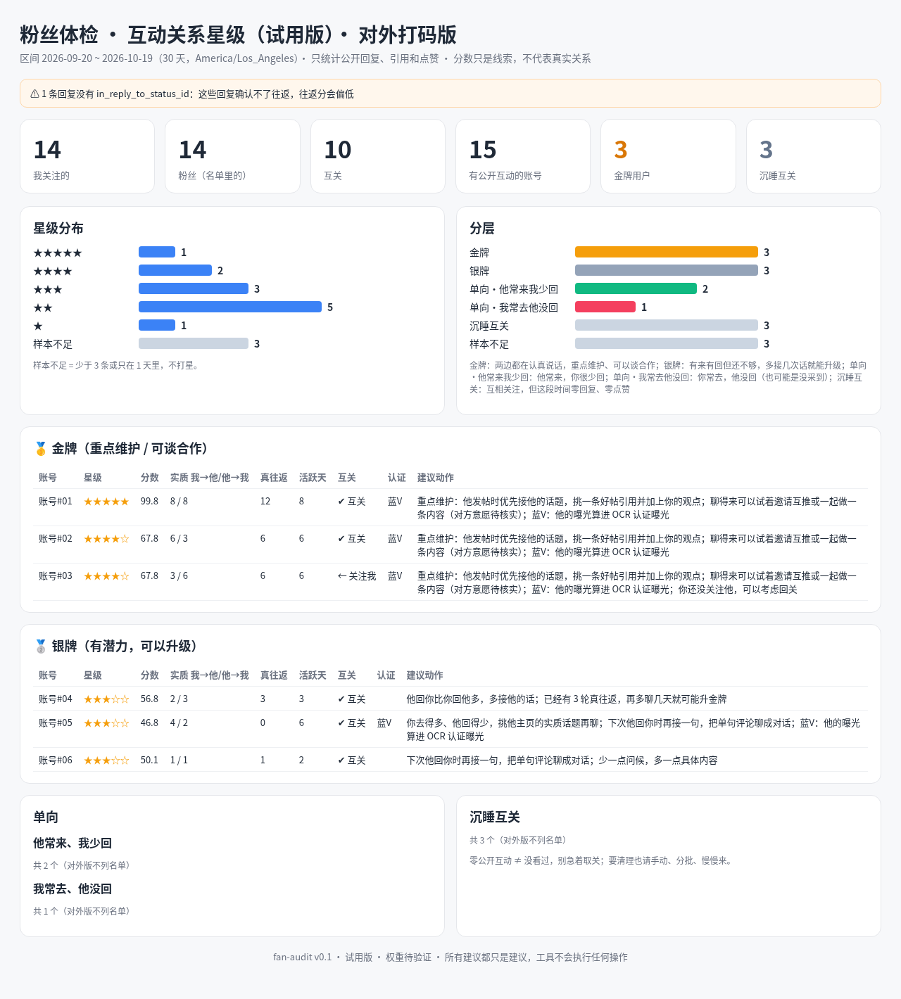

# fan-audit：X 粉丝体检 · 互动关系星级

> 👋 作者正在 X 上连载这个项目的迭代过程，跑不通或有更好的打分建议，欢迎来 X [@ranger_escape](https://x.com/ranger_escape) 找我聊！

**试用版 v0.1 · 权重待验证**

看看谁在跟你认真聊天（金牌用户），谁互关了却很久没说过话（沉睡互关），谁是你一直在回、对方却基本没回过的（单向）。

所有数据只在你自己的浏览器或电脑里处理，不会上传。工具全程只读，不会替你点赞、关注、取关，也不会替你发帖。

## 两种用法，选一种

### 用法一：网页版，看一次结果

不用装环境，点开就能用，大概 5 分钟搞定。

1. **导出数据。** 电脑浏览器装 [twitter-web-exporter](https://github.com/prinsss/twitter-web-exporter) 插件，打开 X，导出「用户推文」「正在关注」「关注者」三份 JSON。具体怎么滚动页面，看 [数据导出教程](docs/DATA_EXPORT.md)。
2. **打开网页。** 直接用浏览器打开本仓库里的 `web/index.html`（双击也行）。
3. **拖进去。** 把三份 JSON 一起拖进页面，不用改文件名，结果马上出来。

要是想截图分享，点一下页面上的「打码模式」，账号名就会自动换成「账号#01」这类代号。

### 用法二：交给 Grok Bot，每天自动更新

适合想长期看互动变化的朋友，特别是正在冲 X 创作者收益的账号。

1. **导入机器人。** 在 Grok Bot 里导入「粉丝体检」机器人模板（链接待补）。
2. **回答几个问题。** 它会问你的 X 用户名、结果放哪里、每晚几点采集。
3. **每周导一次关注名单。** 互动数据它每晚会自动采集，关注关系还要用上面的插件导一下，每周发给它一次就行。

平时想看结果随时跟它说一声，它就会用最新数据给你出一份看板。

## 星级怎么算

只看选定时间段（默认最近 30 天）里你和每个账号之间的公开回复，每人打 0 到 100 分：

| 看什么 | 占比 | 意思 |
|---|---|---|
| 持续性 | 40% | 是不是好几天都有来往，而不是某一天聊了一大串 |
| 双向性 | 35% | 你回他和他回你，次数差不多 |
| 往返轮数 | 25% | 你回了他，他又接着回你，真的聊起来了 |
| 点赞 | 最多加 5 分 | 只是参考，光点赞升不了高星 |

平时打招呼的「早安」「互关」这类客套话不算数；互动太少的人会标「样本不足」，不硬打分。金牌、银牌、单向的具体门槛，看 [规则详解](docs/ADVANCED.md#星级规则详解)。

> 分数只是一份数据参考，不代表真实关系，更不代表对方好不好。没有公开互动，也不等于对方没看你的推文。

## 隐私

- 千万不要用要求导出 cookie 或 token 的工具，这个项目也不需要任何 API key。
- 带真实账号名的看板只留在你自己的电脑里。要是想发出来分享，记得用打码版。
- 不要写脚本去搞自动关注或批量取关，这违反 X 的规则，很容易被限流甚至封号。

## 更多

命令行怎么用、每日自动采集怎么配、生成了哪些文件、Roadmap 和目录结构，都在 [进阶用法](docs/ADVANCED.md)。

## English (brief)

**fan-audit** scores two-way public conversations on X (Twitter). Open `web/index.html` and drop in a twitter-web-exporter JSON export (your tweets, following, followers) or `interactions.csv`. The page calculates stars and tiers in the browser and does not upload anything. A mask button replaces account names before you take a screenshot. The Python command line remains for daily collection: a read-only collector such as Grok Bot can write `interactions.csv`, and `python3 audit.py --data sample_data` runs the same scoring offline. Standard library only, Python 3.9+. Weights are initial values, not yet validated. No automatic likes, follows, or posts. The named dashboard stays on your machine. MIT License.

---

👋 作者正在 X 上连载这个项目的迭代过程，跑不通或有更好的打分建议，欢迎来 X [@ranger_escape](https://x.com/ranger_escape) 找我聊！
