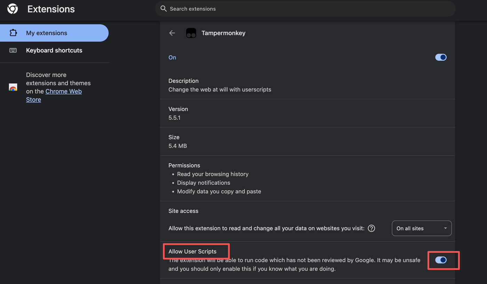
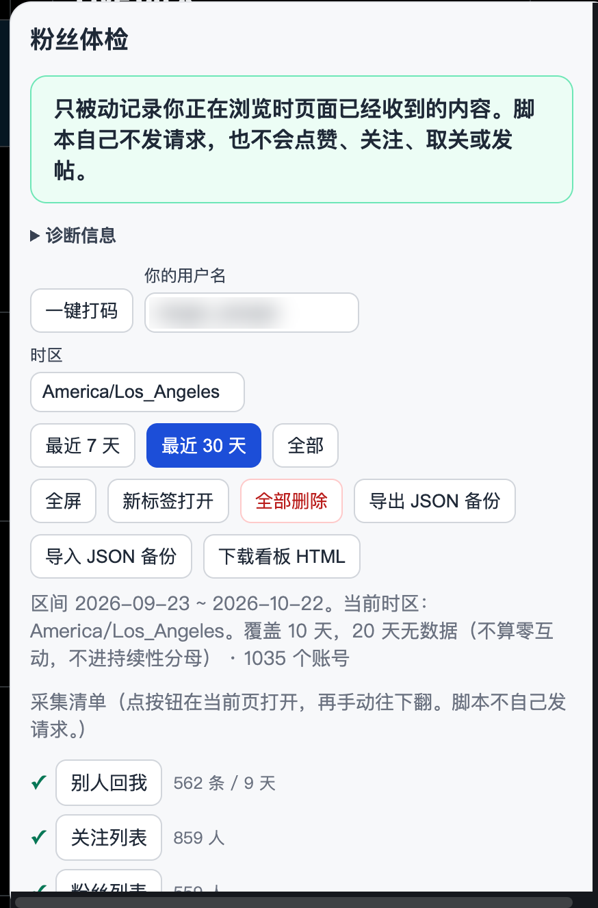
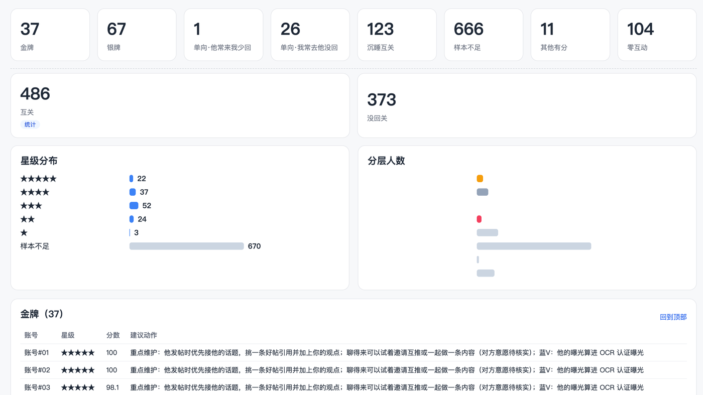

# fan-audit：X 粉丝体检 · 互动关系星级

> 👋 作者正在 X 上连载这个项目的迭代过程，跑不通或有更好的打分建议，欢迎来 X [@ranger_escape](https://x.com/ranger_escape) 找我聊！

**试用版 v0.1 · 权重待验证**

看看谁在跟你认真聊天（金牌用户），
谁互关了却很久没说过话（沉睡互关），
谁是你一直在回、对方却基本没回过的（单向）。

所有数据只在你自己的浏览器或电脑里处理，不会上传。工具不会替你点赞、关注、取关，也不会替你发帖。油猴版默认只记下你自己翻过的内容；自动读取名单是可选项，默认关闭。

## 最简单：油猴版（3 步）

不用导出 JSON，也不用 Grok Bot。装上脚本，打开 X，自己往下翻几屏，点页面右下角的「粉丝体检」。分层和命令行是同一套。已经用 twitter-web-exporter 导出的 JSON，也可以在面板里导入。

这次试用按 Tampermonkey + Chrome 来写。需要 Tampermonkey 5.3 及以上。开关名称按 [Tampermonkey 中文 FAQ Q209「执行用户脚本的权限」](https://www.tampermonkey.net/faq.php?locale=zh&q=Q209) 核对过：Chrome 138+ 是「允许用户脚本」，更早的 Chrome 是「开发者模式」。

### 第 1 步：安装 Tampermonkey

安装浏览器扩展 [Tampermonkey](https://www.tampermonkey.net/)。

### 第 2 步：打开「允许用户脚本」

`chrome://` 开头的地址没法做成可点击的链接，请自己贴到地址栏。

**Chrome 138 及以上**

1. 地址栏打开 `chrome://extensions`。
2. 找到 Tampermonkey，点卡片上的「详细信息」。这一页和 FAQ 里写的「右键点击 Tampermonkey 图标，选择『管理扩展程序』」是同一页。
3. 打开「允许用户脚本」。FAQ 的原文是：找到并启用「允许用户脚本」切换开关。英文版 Chrome 上，这个开关写的是 **Allow User Scripts**。

FAQ 也写了，打开浏览器右上角的「开发者模式」同样能让脚本运行。138 及以上建议只用「允许用户脚本」，不必把整个浏览器的开发者模式打开。英文界面里开发者模式是 **Developer mode**。

**更早的 Chrome**

没有「允许用户脚本」这一项。地址栏打开 `chrome://extensions`，点右上角的开关，启用「开发者模式」。FAQ 的原文是：点击右上角的切换开关启用开发者模式。

装完脚本却完全没反应时，先回来检查这一步。

下面这张是英文版 Chrome 的详情页：红框里 **Allow User Scripts** 已经打开。中文界面上同一开关是「允许用户脚本」。

### 第 3 步：点这个链接安装

用浏览器打开：

https://raw.githubusercontent.com/ratt1e/Xfan-audit/main/userscript/fan-audit.user.js

Tampermonkey 会弹出安装页，点安装。以后脚本更新也走这个链接（文件头里的更新地址指向仓库 `main` 分支上的这份文件）。

然后打开 x.com 并登录。右下角出现「粉丝体检」。刚装好是空的，按下面的清单自己往下翻。默认只记录你浏览过的内容，不自己发请求。面板分成「概览 / 名单 / 采集 / 更多」。自动读取在「采集」，只有一个「自动读取名单」按钮。第一次点开会看到风险提示，勾选后直接开始；读取中这个按钮变成「停止」。刷新后仍是关闭。打码和全屏在主界面；导出、导入、全部删除和诊断在「更多」里。

### 采集清单

面板里每一项都是普通链接，在当前页打开，标 ✓ 或「未采集」，并带上条数或天数。用户名一栏在截图里已经模糊掉。

请依次打开，手动往下翻几屏：

1. **别人回我。** 搜索 `to:你的用户名`，选「最新」。翻到的回复算别人回你。
2. **关注。** 打开自己的关注列表。
3. **粉丝。** 打开自己的粉丝列表。
4. **认证粉丝。** 打开自己的认证粉丝列表。只翻了这一页时，普通粉丝还没记全，没回关会偏多。
5. **主页回复。** 打开自己主页的「回复」页，记下你发出的回复。
6. **通知。** 打开通知的「全部」和「提及」。清单上的按钮指向 `https://x.com/notifications/mentions`。这里只收别人回复你的帖子，和上面的搜索按帖子编号去重。赞、关注、转发那些汇总不记。打开过、但没有回复你的帖子时，写成「已打开，回复 0 条」。

别人回我是搜索页，别一次翻太久。X 会限流，被限了就停下来等一等再翻。这一项请自己往下翻。自动读取只覆盖你自己的名单，默认关闭，在「采集」里勾选后才会由脚本请求接口。面板分成「概览 / 名单 / 采集 / 更多」。默认只读正在关注，并用接口里的「对方是否关注我」判断互关；也可以改成同时读粉丝和认证粉丝。每页大约 100 人，页与页之间不再故意等待，单次最多 120 页。已经记过的一页只要还有下一页就继续翻。进度一行是「读取中 本轮已读 N / 共约 M」。停不停只看这一轮新建的去重人数，不用本机已经存过的人数；没有下一页、游标不动、空页、本轮人数达到公开总数，或到了 120 页，才结束。结束时写本轮读了多少人、多少页。遇到限流、错误状态码，或剩余额度接近 0，会马上停，不自动重试。接口编号优先用页面刚才的请求，否则从 X 已经加载的页面代码里找。登录状态也优先用刚才的请求；没有时用 X 网页公开的令牌，并在你自己的浏览器里读登录 cookie，只为给发往 x.com 的请求带上校验。令牌和 cookie 不保存。读不成就请你自己打开名单页往下翻，脚本仍会记下页面已经加载的内容。

关注、粉丝、认证粉丝旁边会写「已记 N / 共约 M」。分母是页面里已经出现的公开人数；没读到就写「总数待核实」。记到和公开人数接近时，会提示「差不多了」。分层名单里每个账号旁边是回访率、互动条数和确认往返，不写建议。回访率 = 对方回复我的条数 ÷ 我发出的条数（都含问候）。我没有发出过就显示「—」，不显示 0%。打码只换账号名，这些数字仍显示。

### 互动要够才分层

只滑了关注和粉丝、还没采到回复时，互关不会被记成沉睡互关、零互动或单向。互动天数只从回复来，名单快照不算。

分层要等两边都有数据：至少 1 天你发出的回复，并且至少 1 天别人回复你，两边合计不少于 2 个不同日期。没到这个门槛时，面板只保留互关和没回关这些名单统计。只导入名单、没有回复时，用的是同一条规则。

### 全屏、打码、备份

面板分成「概览 / 名单 / 采集 / 更多」。打码、全屏、日期范围和「已排除 N 人」一直放在上面。进度在「概览」，分层名单在「名单」，自动读取在「采集」。导出、导入、下载看板、新标签打开、全部删除、保留名单、排除名单和诊断在「更多」。功能还在。长说明收在可折叠的「说明」里。

- 点「全屏」把面板铺满窗口，再点「退出全屏」或按 Esc 收回。
- 截图前点「一键打码」。账号名会换成「账号#01」，主页链接也会去掉。这个开关会记住。数字和分层仍显示。
- 「导出 JSON 备份」和「导入 JSON 备份」只含打分用的短字段，没有 cookie。换电脑时用这两项。里面也包括保留名单、排除名单和关注快照。默认保留 90 天，要重计可以先「全部删除」，再重新往下翻。全部删除会清掉采集和快照，保留名单和排除名单会留下。备份只留在本机，不要提交。
- 「下载看板 HTML」若被 X 页面拦住，先用 JSON 备份。这一步还要在你自己的浏览器里看一次（待核实）。

### 导入导出的 JSON

已经用 [twitter-web-exporter](https://github.com/prinsss/twitter-web-exporter) 导出的文件，不用再开一个网页。面板上点「导入导出文件」，或把 JSON 拖进面板。一次可以选多份。文件名里的「用户推文 / UserTweets」「正在关注 / Following」「关注者 / Followers」会自动对上；认不出时在「识别为」里改。这是粉丝体检自己的备份的话，会提示改用「导入 JSON 备份」。

导入只写进本机，不上传。再导入一次会换掉上次导入的内容，浏览时记下的还在。

### 保留名单

没回关里，每一行可以点「☆ 保留」。也可以在「保留名单」里自己加、删用户名。这些是你打算继续关注的人，会从「没回关」里拿掉。名单存在本机，打码时改成编号，并跟 JSON 备份一起走。这里没有关注或取关按钮。

### 排除名单

在 X 上 mute 过的人，公开读取接口拿不到那份名单。可以在本机自己记一份排除名单，让这些人不再出现在粉丝体检里。

油猴版：分层名单和没回关的每一行旁边有「排除」。点了只是把这个账号放进本机排除名单。面板上有「已排除 N 人」，点开可以管理。「更多」里也可以粘贴一串账号（逗号、换行、@ 都可以）批量添加，查看数量、移除一个、清空、导出纯文本、导入纯文本。名单存在脚本管理器里，不上传。打码打开后，管理列表只显示编号。

排除只在本地隐藏，不会在 X 上 mute、屏蔽或取关，也不会发这些请求。原始采集不删除，取消排除后这个人会回到名单、人数和看板里。采集清单上的「已记 N / 共约 M」和「差不多了」仍把这些人算作页面上已经读到。快速读取的进度和停止只看本轮去重人数，不看本机已存人数，也不会因为排除了谁就提前停下。排除不改变打分公式和星级门槛。

全部删除会清掉采集和快照，排除名单和保留名单会留下。JSON 备份里也有这份名单，备份只留在本机，不要把真实账号写进仓库。

命令行：把 `排除名单.txt` 放在数据目录（`--data` 那个目录，或 `--data-root` 的数据根目录）。每行一个账号，可以带 @，空行和 # 注释会忽略，大小写不区分，逗号隔开的多个账号也能认。也可以用 `--exclude 文件` 指定别的路径；这个路径不存在会停下来。没有 `排除名单.txt`、也没写 `--exclude` 时，结果和现在一样。分析前会把这些账号从名单和互动里拿掉，`accounts.csv`、`名单.md`、`没回关.md`、看板和人数统计里都不再出现。终端摘要只写「已排除 N 人」，不列名字。这同样只是本地隐藏，不会连接 X。

### 关注变化

每次名单采得够全，就按用户 ID 存一份带日期的快照，再和上一份完整快照比：取关我的、新粉丝、我取关的、我新关注的。显示在「关注变化」里，打码时同样换成编号。

一份名单要同时满足下面两条才算完整，否则标成未完整，只保存、不参与对比，避免把没翻到的人算成取关：

- 人数来自你自己的资料（页面已经收到的 UserByScreenName / UserByRestId）或你主页页头上的关注、粉丝人数。认证粉丝那一栏不算全部粉丝，所以只翻认证粉丝不会当成完整粉丝名单。别人的主页人数不会拿来用。
- 20 人及以下必须正好采齐。再多的话，采到的人数至少要达到资料人数的 95%（向上取整）。人数未知就不算完整。

同一天里页面上的快照只留更全的那一次，避免滑到一半和滑完各算一份。名单和上一份完整快照一模一样时不再存一份新的。只有一份完整快照时，这一节写「下次完整采集后自动对比」。

导入的「关注者 / 正在关注」也各算一份完整快照。日期用文件名末尾的导出时间（13 位毫秒或 10 位秒，例如 `twitter-正在关注-1792582202463.json`），这样以前的导出可以和今天的采集对比。快照跟别的采集一样保留 90 天，但每一侧至少留下最近两份完整的。

全屏并且打开「一键打码」之后，分层卡片和金牌名单里的账号名是「账号#01」这种编号：

### 只读、隐私、平台规则

默认只记下你正在浏览时页面自己已经收到的内容。不点赞、不关注、不取关、不发帖。数据留在脚本管理器里。令牌和 cookie 不会写进备份或诊断。

另有可选的「自动读取」，默认关闭。开启前要勾选风险提示。刷新页面后回到关闭。它不做关注、取关、点赞、转发、回复、私信或拉黑，也不读别人的名单。

开启后脚本自己请求你的正在关注列表，用游标翻页，每页大约 100 人，中间不再故意等待，单次最多 120 页。默认只用这一份名单，并用每个账号上的「对方是否关注我」判断互关；取消勾选后还会读关注者和认证粉丝。已经记过的页会继续往下翻。停止只看这一轮的去重人数：没有下一页、游标不动、空页、本轮人数达到公开总数，或 120 页。本机已经存过的人数不参与这次判断。结束时写本轮读了多少人、多少页。接口编号优先来自页面刚才的同类请求，否则从 X 已经加载的页面代码里查找；遇到 400 或 404 会再找一次。登录状态同样优先用刚才的请求，没有时用 X 网页公开的令牌，并在你自己的浏览器里读取登录 cookie，只为把校验头放进发往 x.com 的请求。令牌和 cookie 不保存、不导出。遇到 429、其他错误状态码，或剩余额度接近 0，马上停，不自动重试。读不成就提示你自己打开名单页往下翻。

只读正在关注时，互关和没回关只覆盖你关注的人：对方关注了你、但你没关注的人不会出现。命令行仍用两份名单；如果正在关注的表里有 `followed_by` 列，会用它修正「对方是否关注我」。没有这一列时，命令行和以前一样。

X 的服务条款不允许未经许可的自动化抓取，可能导致限流、临时限制甚至封号。X 没有公布具体阈值，不能保证安全，后果自负。不想冒险就不要开启自动读取，自己往下翻。记不全是正常的，尤其是「别人回我」。这不能保证账号不受平台规则影响。

### 面板是 0？

展开「诊断信息」，点「复制诊断」，把整段文字发到 [Issues](https://github.com/ratt1e/Xfan-audit/issues)。里面只有接口名和次数，没有账号名。

复制出来的诊断里 GraphQL 一直是 0 时，多半是钩子没进页面环境，或第 2 步的开关没开。这时你自己的关注页、粉丝页上已经显示出来的账号仍可能记下，帖子和回复还是要等钩子接住响应。

源码在 `userscript/`。安装用的单文件是构建结果 `userscript/fan-audit.user.js`。打分公式只在 `engine/fan_audit_engine.js` 里维护一份，油猴版构建时把它打进去，命令行生成的看板也用这一份。

`web/index.html` 现在只是一句说明，不再提供拖拽打分。仓库里的 Pages 工作流也去掉了。如果以前开过 GitHub Pages，页面可能还挂在网上，需要在仓库 Settings → Pages 里把 Source 设成 None，删工作流本身不会把旧页面撤掉。

## 也可以：Grok Bot 模板

适合想长期看互动变化、每晚自动更新的情况。

1. **导入机器人。** 在 Grok Bot 里导入[「粉丝体检」机器人模板](https://x.ai/bot/AYInVUfN_IOql2b7QpzDB)。
2. **回答几个问题。** 它会问你的 X 用户名、结果放哪里、每晚几点采集。
3. **每周导一次关注名单。** 互动数据它每晚会自动采集。关注关系还要用导出插件导一下，每周发给它一次。导出的 JSON 也可以丢进油猴面板的「导入导出文件」，不必再打开单独的网页。

平时想看结果随时跟它说一声，它就会用最新数据给你出一份看板。看板是命令行在你电脑上生成的 HTML。

只导出「用户推文」时，里面主要是你自己发出的回复，对方回你的那一半不在这份文件里，金银牌和往返会偏少。可以再在 X 搜索 `to:你的用户名`，用插件导出搜索结果，在面板里一起导入。搜索要自己往下滚，也受平台限流，仍然可能不全。具体怎么导出，看 [数据导出教程](docs/DATA_EXPORT.md)。

## 星级怎么算

只看选定时间段（默认最近 30 天）里你和每个账号之间的公开回复，每人打 0 到 100 分：

| 看什么 | 占比 | 意思 |
|---|---|---|
| 持续性 | 40% | 是不是好几天都有来往，而不是某一天聊了一大串 |
| 双向性 | 35% | 你回他和他回你，次数差不多 |
| 往返轮数 | 25% | 你回了他，他又接着回你，真的聊起来了 |
| 点赞 | 最多加 5 分 | 只是参考，光点赞升不了高星 |

平时打招呼的「早安」「互关」这类客套话不算数；互动太少的人会标「样本不足」，不硬打分。金牌、银牌、单向的具体门槛，看 [规则详解](docs/ADVANCED.md#星级规则详解)。

> 分数只是一份数据参考，不代表真实关系，更不代表对方好不好。没有公开互动，也不等于对方没看你的推文。

## 隐私

- 千万不要用要求导出 cookie 或 token 的工具，这个项目也不需要任何 API key。
- 带真实账号名的看板只留在你自己的电脑里。要是想发出来分享，记得用打码版。
- 不要写脚本去搞自动关注或批量取关，这违反 X 的规则，很容易被限流甚至封号。

## 更多

命令行怎么用、每日自动采集怎么配、生成了哪些文件、Roadmap 和目录结构，都在 [进阶用法](docs/ADVANCED.md)。每晚刷新可以加上 `--auto-prev`，自动对比上一份关注和粉丝导出。私人看板有「打码模式」，只改这一页的显示，文件里仍有真实账号名；要外发请用 `dashboard_public.html`。详见 [每天看看板](docs/ADVANCED.md#每天看看板)。

## English (brief)

**fan-audit** scores two-way public conversations on X (Twitter). The easiest try is the Tampermonkey script: install Tampermonkey 5.3+, turn on Chrome’s “Allow User Scripts” (Chrome 138+: `chrome://extensions` → Tampermonkey details; earlier Chrome: Developer Mode; see [Tampermonkey FAQ Q209](https://www.tampermonkey.net/faq.php?locale=en&q=Q209)), then open `https://raw.githubusercontent.com/ratt1e/Xfan-audit/main/userscript/fan-audit.user.js`. On x.com, scroll your following, followers, replies, a `to:username` search, and notifications. By default the script only reads responses the page already loaded while you scroll, keeps replies to you, skips like, follow, and repost bundles, stores short fields for 90 days, and does not send its own requests or scroll. An optional list reader is off by default and asks you to confirm the risk first. You can choose slow scrolling (about 1–2 seconds per screen, up to 220 screens) or a faster mode that pages your own following and followers with the list request the page already made. The faster mode sends those list requests itself, which is automated scraping and riskier than scrolling. It does not promise the account will be unaffected. Mask names before a screenshot. Lists show a return rate (their replies divided by yours, or an em dash when you sent none), not advice. A local whitelist hides accounts you mean to keep following from the not-followed-back list. Follow and follower changes are diffed only between complete snapshots (the captured count matches a small list exactly, or reaches 95% of the profile count on a larger one); a partial snapshot is stored and not diffed. Imported follower and following files count as snapshots dated by the export time in the filename. X's terms prohibit unauthorized automated scraping. The optional reader stays off unless you turn it on, and this does not promise the account will be unaffected. The other path is the [Grok Bot template](https://x.ai/bot/AYInVUfN_IOql2b7QpzDB) for a nightly read-only collect. A 「用户推文」 export is only the posts you sent; gold, silver, and round-trip scores stay low until replies to you are included. Drop those JSON files into the userscript panel; nothing is uploaded. Share `dashboard_public.html` when a file still contains real names. The Python command line remains for daily files: `python3 audit.py --data sample_data --tz America/Los_Angeles`. `--tz` overrides `config.json`, which overrides the computer's local timezone. Standard library only, Python 3.9+. Weights are initial values, not yet validated. No automatic likes, follows, or posts. MIT License.

---

👋 作者正在 X 上连载这个项目的迭代过程，跑不通或有更好的打分建议，欢迎来 X [@ranger_escape](https://x.com/ranger_escape) 找我聊！
